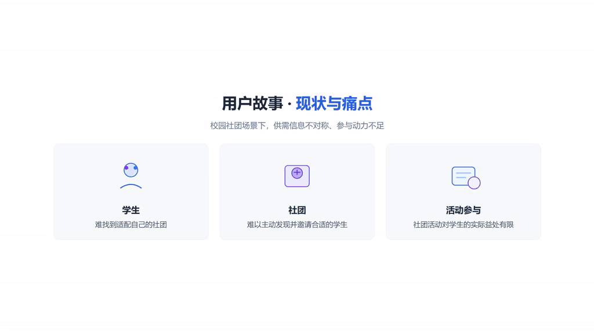
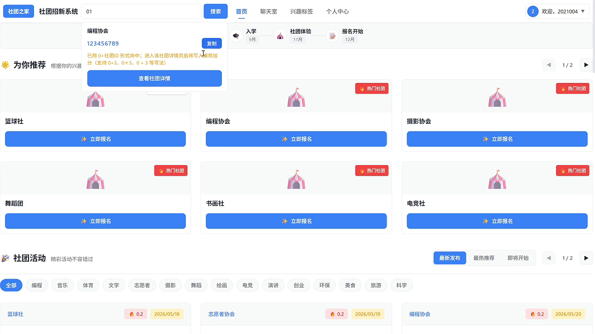
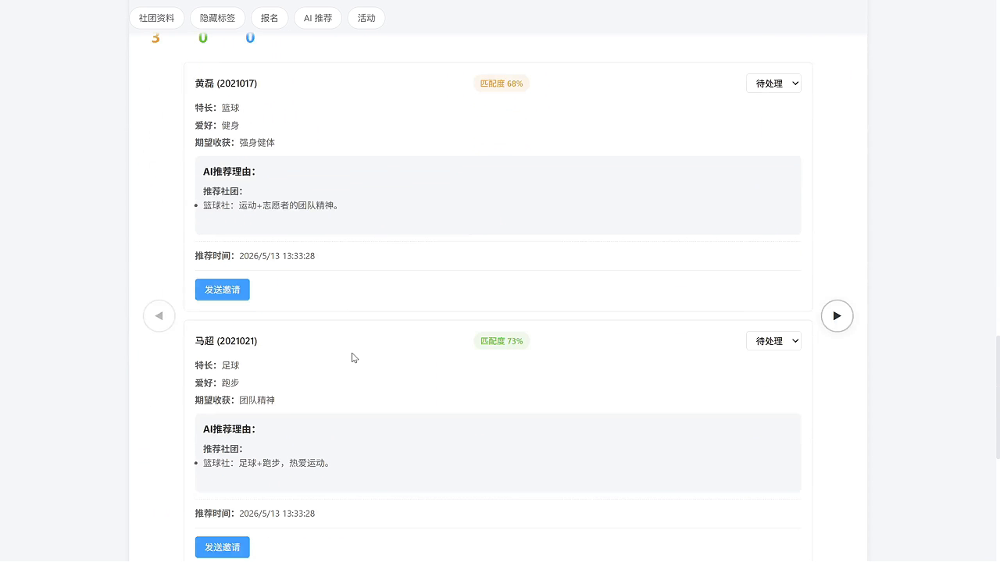
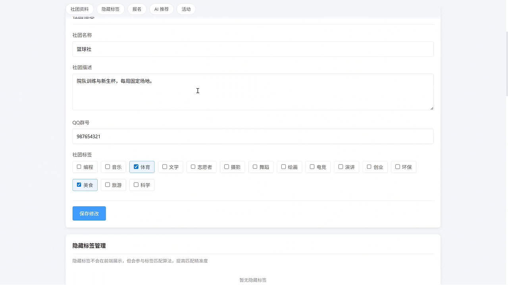
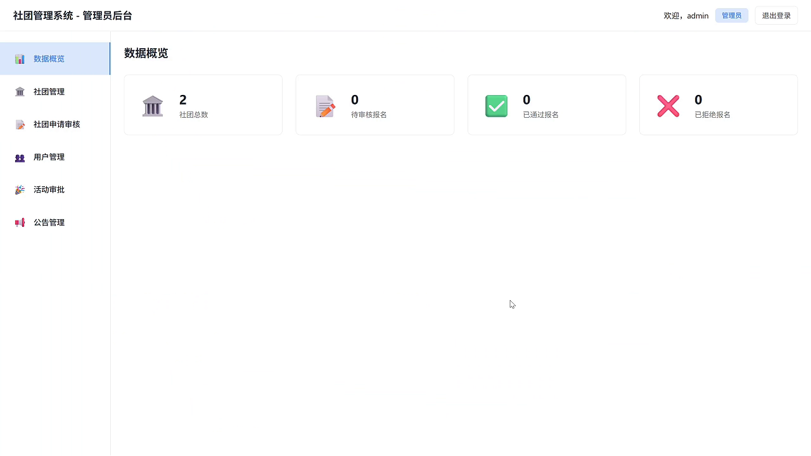
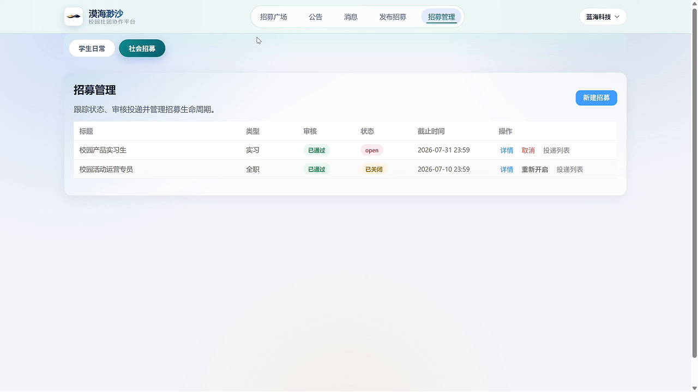

<div align="center">

# 校园社团平台 · 基于个性化推荐的社团管理系统

**让学生找到合适的社团，让社团找到对的人**

基于「Jaccard 标签相似度 + 隐藏标签 + QQ 社群关联」的混合推荐算法，
解决校园社团场景下新用户、新社团的**冷启动**难题




[▶ 观看 1 分钟系统演示视频](docs/media/demo.mp4)

</div>

---

## 一、这是什么项目

一个**前后端分离的校园社团一站式平台**，覆盖「学生选社团 → 社团招新 → 活动组织 → 平台审核 → 社会招聘进校园」的完整闭环。

与普通社团管理系统最大的区别在于：**推荐是系统的核心，而不是附属功能**。新用户注册后只需填写一份兴趣问卷，系统就能在没有任何历史行为数据的情况下给出带匹配度和推荐理由的社团排序，社团管理员也能看到候选人的匹配报告并主动发出邀请。

| 角色 | 能做什么 |
| --- | --- |
| 🎓 学生 | 兴趣问卷与标签、个性化社团推荐、浏览/报名社团、参加活动、问卷投票、知识库、站内聊天、行为足迹 |
| 🏛 社团管理员 | 维护社团资料、设置**公开标签与隐藏标签**、发布活动、审核报名、查看 AI 候选人匹配报告、主动邀请学生 |
| 🛡 平台管理员 | 社团与活动审核、用户管理、公告管理、数据概览 |
| 💼 社会招聘方 | 发布实习/全职招募、查看投递、处理候选人（发布 → 平台审核 → 学生投递 → 处理） |

### 为什么做这个系统

校园社团场景长期存在**供需信息不对称**的问题：

- **学生**：社团数量多、信息分散，很难判断哪个社团真正适合自己；
- **社团**：招新靠海报和扫楼，触达不了真正感兴趣的学生；
- **活动**：社团活动与学生兴趣错位，参与动力不足。

因此本项目把「个性化推荐」作为核心能力，用标签体系 + 社交关系补足冷启动阶段的数据缺失。

---

## 二、核心亮点：冷启动混合推荐

传统协同过滤依赖大量历史行为，新用户、新社团天然没有数据。本项目采用**混合推荐**，无需行为数据即可冷启动：

```
总分 = Jaccard(学生兴趣标签, 社团公开标签) × 60
     + min(命中隐藏标签数 × 5, 20)
     + QQ 社群关联加分（命中 +20）

相似度 = min(1.0, 总分 / 100)
```

| 推荐信号 | 作用 | 默认权重 |
| --- | --- | --- |
| 公开标签 Jaccard 相似度 | 学生主动选择的兴趣 vs 社团公开展示的标签 | 60 |
| 隐藏标签命中 | 社团不对外展示的偏好标签（如「能坚持训练」），由系统参与匹配，提高精准度 | 每命中 +5，上限 20 |
| QQ 社群关联 | 学生已加入的 QQ 群 / 推荐加成社团，利用校内真实社交关系做加权 | +20 |

这套权重并非写死在代码里：`recommendation_rule` 表保存权重，可在数据库中调整，无需重新发版。

在此基础上，系统还会通过 **DeepSeek Chat API** 生成可解释的推荐理由与候选人匹配报告（API Key 通过环境变量注入，未配置时自动降级为本地规则文案），让推荐结果"看得懂、可解释"，管理员可以据此一键向学生发出邀请。

> 算法细节与 Python 原型、Java 实现的逐项对比见 [推荐算法对比文档](docs/RECOMMENDATION_COMPARISON.md)。

---

## 三、系统架构

```
┌────────────────────────────── 前端 Vue 3 SPA ──────────────────────────────┐
│  学生端：首页推荐 / 社团 / 活动 / 招新 / 问卷投票 / 知识库 / 聊天 / 个人中心     │
│  社团端：社团资料 / 公开·隐藏标签 / 活动发布 / 报名管理 / AI 匹配 / 主动邀请     │
│  平台管理员：社团审核 / 活动审核 / 用户管理 / 公告 / 数据概览                   │
│  社会招聘方：招募发布 → 平台审核 → 学生投递 → 候选人处理                       │
└──────────────────────────────┬────────────────────────────────────────────┘
                               │ Axios + JWT（/api，Vite 开发代理 → 8080）
┌──────────────────────────────▼────────────────────────────────────────────┐
│                 Spring Boot 3.2.12 多模块后端（backend-application 启动）      │
│  backend-club          社团 · 活动 · 社团标签                                │
│  backend-recruitment   招新 · 成员 · 学生标签 · 招募帖                        │
│  backend-platform      推荐引擎 · AI 匹配解读 · 聊天 · 公告 · 内容 · 行为      │
│  backend-admin         认证 · 用户 · 审核                                    │
│  backend-common        统一响应 · JWT · 全局异常 · MyBatis-Plus 配置          │
└──────────────────────────────┬────────────────────────────────────────────┘
                               │ MyBatis-Plus
                  MySQL 8.0（club_home） + Redis 7.0（可选缓存）
```

### 技术栈

| 层次 | 技术选型 |
| --- | --- |
| 前端 | Vue 3.4、Vite 5、Vue Router 4、Axios、原生 CSS（无 UI 框架，组件自研） |
| 后端 | JDK 17、Spring Boot 3.2.12、MyBatis-Plus 3.5.6、JWT（jjwt 0.12.5）、Maven 多模块 |
| 数据 | MySQL 8.0、Redis 7.0（可选） |
| AI | DeepSeek Chat API（可配置，缺省本地降级） |

---

## 四、界面预览

<table>
  <tr>
    <td width="50%"><br/><sub><b>首页「为你推荐」</b>：登录即见匹配社团与热门社团</sub></td>
    <td width="50%"><br/><sub><b>AI 候选人匹配报告</b>：匹配度 + 推荐理由 + 一键邀请</sub></td>
  </tr>
  <tr>
    <td><br/><sub><b>隐藏标签管理</b>：不公开展示，但参与推荐计算</sub></td>
    <td><br/><sub><b>平台管理后台</b>：社团/报名/活动审批与数据概览</sub></td>
  </tr>
  <tr>
    <td colspan="2" align="center"><br/><sub><b>社会招募端</b>：招募发布与投递处理，打通校园与社会资源</sub></td>
  </tr>
</table>

---

## 五、快速开始

**环境要求**：JDK 17、Maven 3.8+（或 IDEA 内置 Maven）、Node.js 16+、MySQL 8.0

### 1. 初始化数据库

```bash
mysql -u root -p < all-backend/src/main/resources/db/club_home_complete.sql
```

脚本会创建 `club_home` 库，并写入表结构、标签字典与测试数据。

### 2. 启动后端

修改 `all-backend/backend-application/src/main/resources/application-dev.yml` 中的数据库账号密码（Redis 可选），然后：

```bash
cd all-backend
mvn -pl backend-application -am spring-boot:run
```

也可以直接用 IDEA 打开 `all-backend`，运行 `EndtiemApplication`。后端默认端口 `8080`。

> 可选：配置环境变量 `DEEPSEEK_API_KEY` 以启用 AI 推荐理由生成；不配置时使用本地规则文案。

### 3. 启动前端

```bash
cd all_frontend
npm install
npm run dev
```

访问 <http://localhost:5174>（已配置 `/api` 代理到 `localhost:8080`）。

### 4. 测试账号（来自初始化 SQL）

| 角色 | 账号 | 密码 |
| --- | --- | --- |
| 平台管理员 | `admin001` | `admin123` |
| 学生 | `student01` / `student02` / `student05` | `123456` |
| 社团管理员 | `clubadmin1` / `clubadmin2` / `clubadmin3` | `123456` |

---

## 六、目录结构

```
endtiem/
├── all_frontend/                 Vue 3 前端
│   └── src/
│       ├── views/                首页 / 社团 / 活动 / 招新 / 问卷投票 / 知识库 / 聊天 / 管理后台
│       ├── api/modules/          按业务拆分的 API 模块
│       ├── components/           通用组件、骨架屏、布局
│       └── router/               路由与登录/管理员守卫
├── all-backend/                  Spring Boot 多模块后端
│   ├── backend-application/      启动类、配置、数据库脚本（db/club_home_complete.sql）
│   ├── backend-club/             社团与活动
│   ├── backend-recruitment/      招新、成员、标签、招募帖
│   ├── backend-platform/         推荐引擎、AI 解读、聊天、公告、内容、行为
│   ├── backend-admin/            认证、用户、审核
│   └── backend-common/           统一响应、JWT、异常、配置
├── docs/                         论文、系统设计、算法对比、截图、演示视频
└── 足迹/                         开发过程记录（问题定义、可行性分析、日记）
```

---

## 七、文档索引

| 文档 | 内容 |
| --- | --- |
| [thesis.md](docs/論文/thesis.md) | 毕业设计论文全文（摘要、需求、设计、测试） |
| [system_design.md](docs/论文/system_design.md) | 系统设计（架构、模块、数据库、接口） |
| [requirements_analysis_plan.md](docs/论文/requirements_analysis_plan.md) | 需求分析与实施计划 |
| [RECOMMENDATION_COMPARISON.md](docs/RECOMMENDATION_COMPARISON.md) | 推荐算法：Python 原型 vs Java 实现 |
| [API_ALIGNMENT.md](docs/API_ALIGNMENT.md) | 前后端接口对齐说明 |

---

## 说明

本项目为本科毕业设计作品，代码与文档主要用于学习交流。若需商用请联系作者。
