# 社团之家系统设计文档

## 一、技术栈设计

### 1.1 后端技术栈

| 类别 | 技术选型 | 版本 | 选型理由 |
|------|----------|------|----------|
| **核心框架** | Spring Boot | 3.2.12 | 主流企业级Java框架，提供快速开发能力，内置Tomcat服务器，支持自动配置 |
| **Java版本** | JDK | 17 | LTS长期支持版本，提供最新Java特性（Records、Sealed Classes、Pattern Matching等） |
| **ORM框架** | MyBatis-Plus | 3.5.6 | 增强版MyBatis，简化CRUD操作，提供代码生成器，支持分页、性能分析等功能 |
| **数据库** | MySQL | 8.0 | 成熟稳定的关系型数据库，支持utf8mb4字符集，提供优秀的查询性能和事务支持 |
| **缓存** | Redis | 7.0 | 高性能内存数据库，用于Session缓存、热点数据缓存、分布式锁等场景 |
| **身份认证** | JWT | 0.12.5 | 无状态身份令牌，支持分布式部署，减轻服务器Session存储压力 |
| **代码简化** | Lombok | - | 简化POJO代码，自动生成Getter/Setter/Constructor等方法 |
| **代码规范** | Spotless | 2.39.0 | 代码格式化插件，使用Google Java Format风格，确保团队代码风格一致 |
| **AOP** | Spring AOP | - | 面向切面编程，用于日志拦截、权限验证、事务管理等横切关注点 |

### 1.2 前端技术栈

| 类别 | 技术选型 | 版本 | 选型理由 |
|------|----------|------|----------|
| **核心框架** | Vue | 3.4.0 | 渐进式JavaScript框架，Composition API提供更好的代码组织和复用能力 |
| **构建工具** | Vite | 5.0.0 | 下一代前端构建工具，基于ES Module，开发启动速度快，HMR性能优秀 |
| **路由管理** | Vue Router | 4.2.5 | Vue官方路由管理器，支持嵌套路由、路由守卫、懒加载等特性 |
| **HTTP客户端** | Axios | 1.13.6 | 基于Promise的HTTP客户端，支持请求/响应拦截器、取消请求、自动转换JSON等 |
| **代码规范** | ESLint + Prettier | - | 代码检查与格式化工具，确保代码质量和风格统一 |

### 1.3 基础设施

| 类别 | 技术选型 | 说明 |
|------|----------|------|
| **API设计** | RESTful | 统一REST接口风格，遵循HTTP语义，资源导向设计 |
| **身份认证** | JWT Bearer Token | 无状态认证机制，Token存储在客户端，服务器无需存储Session |
| **文件存储** | 本地文件系统 | 通过WebConfig映射访问，支持图片、文档等文件上传 |
| **AI服务** | DeepSeek API | 智能推荐能力，提供社团推荐、内容生成等功能 |
| **版本控制** | Git | 分布式版本控制系统，支持分支管理、代码回滚等 |

### 1.4 开发工具

| 工具 | 用途 |
|------|------|
| **IntelliJ IDEA** | Java后端开发IDE |
| **Visual Studio Code** | 前端开发编辑器 |
| **Maven** | 后端项目构建和依赖管理 |
| **npm/pnpm** | 前端包管理工具 |
| **MySQL Workbench** | 数据库管理工具 |
| **Redis Desktop Manager** | Redis可视化管理工具 |

---

## 二、系统架构设计

### 2.1 整体架构图

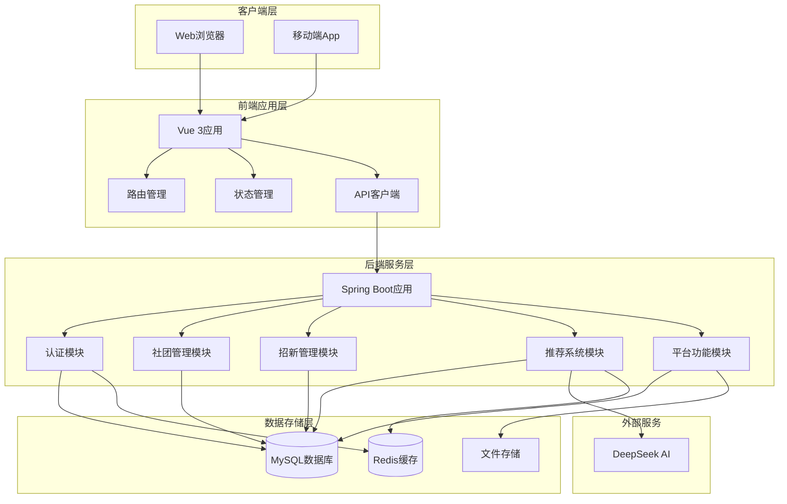

### 2.2 后端Maven多模块架构

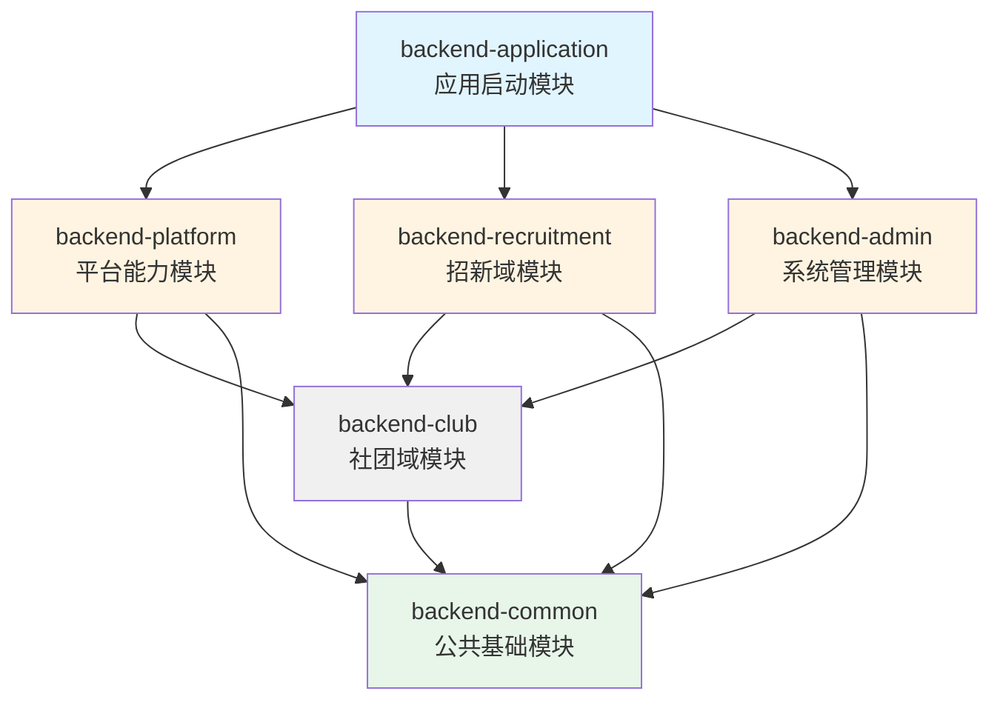

**模块职责说明**：

| 模块 | 职责 | 核心功能 |
|------|------|----------|
| **backend-common** | 横切关注点 | 统一响应格式、全局异常处理、JWT工具类、AOP日志拦截、文件上传配置 |
| **backend-admin** | 用户管理域 | 用户CRUD、邀请码管理、用户行为足迹记录 |
| **backend-club** | 社团域 | 社团信息管理、活动发布、标签管理、问卷投票、问答系统 |
| **backend-recruitment** | 招新域 | 招新帖发布、申请流程管理、教程系统、用户标签管理 |
| **backend-platform** | 平台能力域 | AI推荐、行为分析、公告管理、实时聊天、文件上传 |
| **backend-application** | 应用入口 | Spring Boot启动类、配置文件加载、Bean扫描 |

### 2.3 后端分层架构

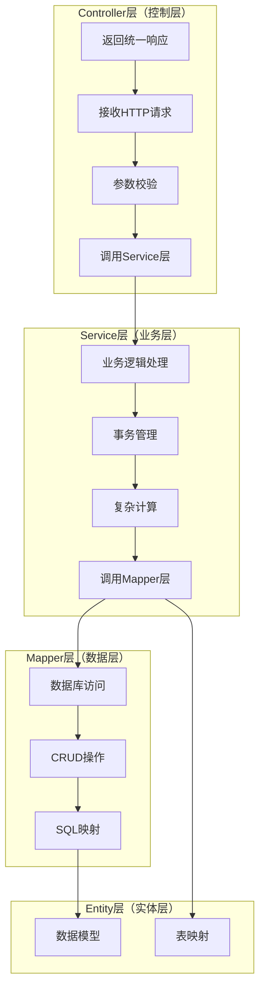

**分层职责**：

- **Controller层**：接收HTTP请求，进行参数校验，调用Service层处理业务逻辑，返回统一格式的响应
- **Service层**：处理核心业务逻辑，管理事务，进行复杂计算，调用Mapper层访问数据库
- **Mapper层**：负责数据库访问，执行CRUD操作，使用MyBatis-Plus简化开发
- **Entity层**：定义数据模型，与数据库表映射

### 2.4 前端架构设计

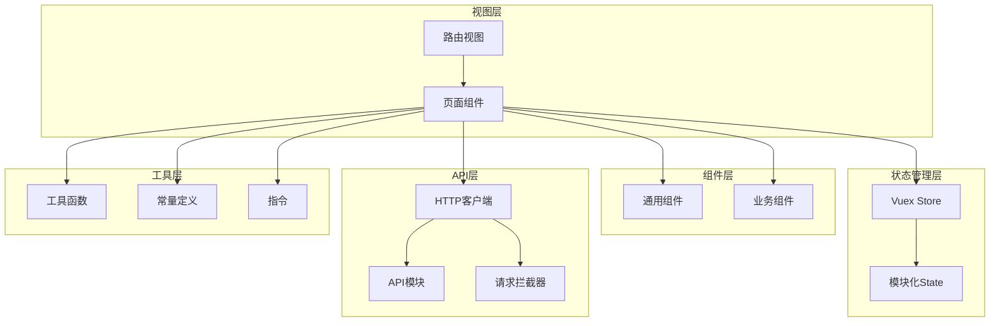

**前端目录结构**：

```
all_frontend/
├── src/
│   ├── api/                    # API请求模块化
│   │   ├── http.js            # Axios实例与拦截器
│   │   ├── client.js          # API客户端封装
│   │   └── modules/           # 分模块API
│   │       ├── activity.js    # 活动API
│   │       ├── auth-home.js   # 认证API
│   │       ├── club.js        # 社团API
│   │       └── ...
│   ├── components/            # 公共组件
│   │   ├── knowledge/         # 知识库组件
│   │   └── ThemeToggle.vue    # 主题切换组件
│   ├── views/                  # 页面视图
│   │   ├── Home.vue           # 首页
│   │   ├── ClubList.vue       # 社团列表
│   │   ├── ClubDetail.vue     # 社团详情
│   │   └── ...
│   ├── router/                 # 路由配置
│   ├── store/                  # 状态管理
│   ├── utils/                  # 工具函数
│   ├── directives/             # Vue指令
│   └── constants/              # 常量定义
├── vite.config.ts             # Vite配置
└── package.json               # 依赖管理
```

---

## 三、数据库设计

### 3.1 数据库架构图

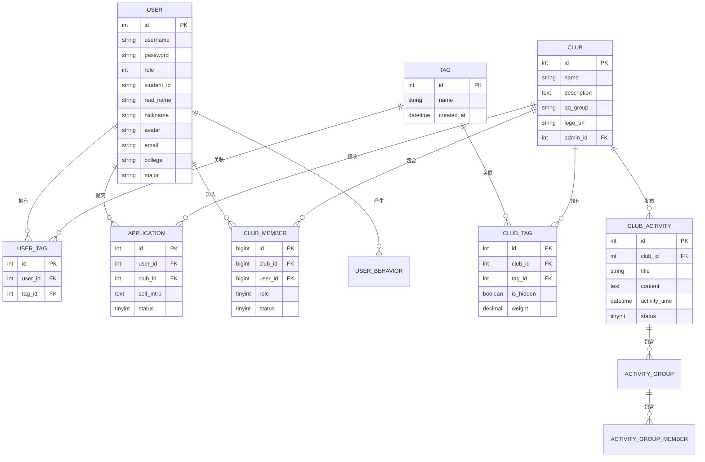

### 3.2 核心数据表设计

#### 3.2.1 用户表（user）

**表结构**：

| 字段名 | 类型 | 约束 | 说明 |
|--------|------|------|------|
| id | INT | PRIMARY KEY, AUTO_INCREMENT | 用户ID |
| username | VARCHAR(50) | NOT NULL, UNIQUE | 登录用户名 |
| password | VARCHAR(255) | NOT NULL | 密码（加密存储） |
| role | INT | NOT NULL, DEFAULT 0 | 角色：0学生 1社团管理员 2平台管理员 |
| student_id | VARCHAR(50) | UNIQUE | 学号 |
| real_name | VARCHAR(50) | | 真实姓名 |
| nickname | VARCHAR(50) | | 昵称 |
| avatar | VARCHAR(500) | | 头像URL |
| email | VARCHAR(100) | UNIQUE | 邮箱 |
| college | VARCHAR(100) | | 学院 |
| major | VARCHAR(100) | | 专业 |
| grade | INT | | 年级 |
| specialty | VARCHAR(200) | | 特长 |
| hobby | VARCHAR(200) | | 爱好 |
| expectation | VARCHAR(500) | | 期望 |
| recommend_boost_club_id | INT | | 推荐加成社团ID |
| invite_code | VARCHAR(20) | | 用户生成的邀请码 |
| invited_by | INT | | 邀请人用户ID |
| created_at | DATETIME | NOT NULL, DEFAULT CURRENT_TIMESTAMP | 创建时间 |

**索引设计**：
- `uk_username`：用户名唯一索引
- `uk_student_id`：学号唯一索引
- `uk_email`：邮箱唯一索引

#### 3.2.2 标签表（tag）

**表结构**：

| 字段名 | 类型 | 约束 | 说明 |
|--------|------|------|------|
| id | INT | PRIMARY KEY, AUTO_INCREMENT | 标签ID |
| name | VARCHAR(50) | NOT NULL, UNIQUE | 标签名称 |
| created_at | DATETIME | NOT NULL, DEFAULT CURRENT_TIMESTAMP | 创建时间 |

#### 3.2.3 用户标签关联表（user_tag）

**表结构**：

| 字段名 | 类型 | 约束 | 说明 |
|--------|------|------|------|
| id | INT | PRIMARY KEY, AUTO_INCREMENT | ID |
| user_id | INT | NOT NULL, FOREIGN KEY | 用户ID |
| tag_id | INT | NOT NULL, FOREIGN KEY | 标签ID |

**索引设计**：
- `uk_user_tag`：用户ID和标签ID联合唯一索引
- `idx_user`：用户ID索引
- `idx_tag`：标签ID索引

#### 3.2.4 社团表（club）

**表结构**：

| 字段名 | 类型 | 约束 | 说明 |
|--------|------|------|------|
| id | INT | PRIMARY KEY, AUTO_INCREMENT | 社团ID |
| name | VARCHAR(100) | NOT NULL | 社团名称 |
| description | TEXT | | 社团描述 |
| qq_group | VARCHAR(50) | | QQ群 |
| logo_url | VARCHAR(500) | | Logo URL |
| admin_id | INT | FOREIGN KEY | 管理员用户ID |
| created_at | DATETIME | NOT NULL, DEFAULT CURRENT_TIMESTAMP | 创建时间 |

#### 3.2.5 社团标签关联表（club_tag）

**表结构**：

| 字段名 | 类型 | 约束 | 说明 |
|--------|------|------|------|
| id | INT | PRIMARY KEY, AUTO_INCREMENT | ID |
| club_id | INT | NOT NULL, FOREIGN KEY | 社团ID |
| tag_id | INT | NOT NULL, FOREIGN KEY | 标签ID |
| is_hidden | TINYINT(1) | NOT NULL, DEFAULT 0 | 是否隐藏：0显示 1隐藏 |
| weight | DECIMAL(5,2) | DEFAULT 1.00 | 权重 |
| description | VARCHAR(200) | | 描述 |

**索引设计**：
- `uk_club_tag`：社团ID和标签ID联合唯一索引
- `idx_club`：社团ID索引
- `idx_tag`：标签ID索引

#### 3.2.6 社团成员表（club_member）

**表结构**：

| 字段名 | 类型 | 约束 | 说明 |
|--------|------|------|------|
| id | BIGINT | PRIMARY KEY, AUTO_INCREMENT | 成员ID |
| club_id | BIGINT | NOT NULL | 社团ID |
| user_id | BIGINT | NOT NULL | 用户ID |
| role | TINYINT | NOT NULL, DEFAULT 1 | 角色：1成员 2管理员 3负责人 |
| join_time | DATETIME | DEFAULT CURRENT_TIMESTAMP | 加入时间 |
| status | TINYINT | NOT NULL, DEFAULT 1 | 状态：1在社 2待审 3已退出 |
| created_at | DATETIME | NOT NULL, DEFAULT CURRENT_TIMESTAMP | 创建时间 |
| updated_at | DATETIME | NOT NULL, DEFAULT CURRENT_TIMESTAMP ON UPDATE | 更新时间 |

**索引设计**：
- `uk_club_user`：社团ID和用户ID联合唯一索引
- `idx_user`：用户ID索引
- `idx_club`：社团ID索引

#### 3.2.7 入社申请表（application）

**表结构**：

| 字段名 | 类型 | 约束 | 说明 |
|--------|------|------|------|
| id | INT | PRIMARY KEY, AUTO_INCREMENT | 申请ID |
| user_id | INT | NOT NULL, FOREIGN KEY | 用户ID |
| club_id | INT | NOT NULL, FOREIGN KEY | 社团ID |
| self_intro | TEXT | | 自我介绍 |
| phone | VARCHAR(20) | | 手机号 |
| status | TINYINT | NOT NULL, DEFAULT 0 | 状态：0待审 1通过 2拒绝 |
| reject_reason | VARCHAR(500) | | 拒绝原因 |
| submitted_at | DATETIME | | 提交时间 |
| reviewed_at | DATETIME | | 审核时间 |

**索引设计**：
- `idx_club_status`：社团ID和状态联合索引
- `idx_user`：用户ID索引

#### 3.2.8 社团活动表（club_activity）

**表结构**：

| 字段名 | 类型 | 约束 | 说明 |
|--------|------|------|------|
| id | INT | PRIMARY KEY, AUTO_INCREMENT | 活动ID |
| club_id | INT | NOT NULL, FOREIGN KEY | 社团ID |
| title | VARCHAR(200) | NOT NULL | 活动标题 |
| content | TEXT | | 活动内容 |
| image_url | VARCHAR(500) | | 图片URL |
| activity_time | DATETIME | | 活动时间 |
| location | VARCHAR(200) | | 活动地点 |
| current_participants | INT | NOT NULL, DEFAULT 0 | 当前报名人数 |
| max_participants | INT | | 最大报名人数 |
| status | TINYINT | NOT NULL, DEFAULT 0 | 状态：0待审 1通过 2拒绝 |
| reject_reason | VARCHAR(500) | | 拒绝原因 |
| tags | VARCHAR(500) | | 标签，多个用逗号分隔 |
| created_at | DATETIME | NOT NULL, DEFAULT CURRENT_TIMESTAMP | 创建时间 |
| updated_at | DATETIME | NOT NULL, DEFAULT CURRENT_TIMESTAMP ON UPDATE | 更新时间 |
| reviewed_at | DATETIME | | 审核时间 |

**索引设计**：
- `idx_club`：社团ID索引
- `idx_status`：状态索引
- `idx_participants`：报名人数索引

### 3.3 数据库设计原则

1. **规范化设计**：遵循第三范式，减少数据冗余
2. **索引优化**：为常用查询字段建立索引，提高查询性能
3. **外键约束**：使用外键保证数据一致性
4. **字符集**：统一使用utf8mb4字符集，支持emoji等特殊字符
5. **时间戳**：所有表包含created_at字段，关键表包含updated_at字段
6. **软删除**：重要数据使用status字段标记状态，不物理删除

---

## 四、冷启动推荐模块详细设计

### 4.1 冷启动问题分析

**冷启动场景**：

1. **新用户冷启动**：新注册用户没有历史行为数据，无法进行协同过滤推荐
2. **新社团冷启动**：新创建的社团没有成员和活动数据，难以被推荐
3. **新内容冷启动**：新发布的活动、招新帖等内容缺乏互动数据

**解决方案**：

本系统采用**基于标签的冷启动推荐策略**，通过用户选择的兴趣标签和实体的标签属性进行匹配推荐。

### 4.2 推荐系统架构

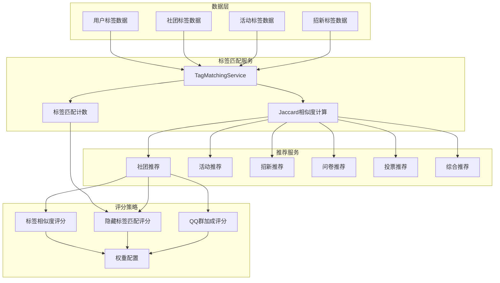

### 4.3 核心算法设计

#### 4.3.1 Jaccard相似度算法

**算法原理**：

Jaccard相似度用于计算两个集合的相似程度，公式为：

```
Jaccard(A, B) = |A ∩ B| / |A ∪ B|
```

其中：
- `A ∩ B`：集合A和集合B的交集
- `A ∪ B`：集合A和集合B的并集
- `|S|`：集合S的元素个数

**代码实现**：

```java
/**
 * 计算两个标签集合的 Jaccard 相似度
 * Jaccard = |A ∩ B| / |A ∪ B|
 * 
 * @param set1 标签集合1
 * @param set2 标签集合2
 * @return 相似度分数 [0.0, 1.0]
 */
public double calculateJaccardSimilarity(Set<Integer> set1, Set<Integer> set2) {
    if (set1 == null || set2 == null) {
        return 0.0;
    }
    if (set1.isEmpty() && set2.isEmpty()) {
        return 0.0;
    }

    Set<Integer> intersection = new HashSet<>(set1);
    intersection.retainAll(set2);

    Set<Integer> union = new HashSet<>(set1);
    union.addAll(set2);

    if (union.isEmpty()) {
        return 0.0;
    }

    return (double) intersection.size() / union.size();
}
```

**算法特点**：
- 结果范围：[0.0, 1.0]，值越大表示相似度越高
- 适用于集合类型数据
- 对集合大小不敏感
- 计算简单，性能高

#### 4.3.2 社团推荐评分算法

**评分公式**：

```
TotalScore = TagScore + HiddenScore + QQBoostScore
```

其中：

1. **标签相似度评分（TagScore）**：
   ```
   TagScore = Jaccard(UserTags, ClubVisibleTags) × MaxTagScore
   ```
   - `UserTags`：用户选择的标签集合
   - `ClubVisibleTags`：社团的可见标签集合
   - `MaxTagScore`：标签评分最大值（默认60分）

2. **隐藏标签匹配评分（HiddenScore）**：
   ```
   HiddenScore = min(MaxHiddenScore, MatchCount × HiddenMatchUnit)
   ```
   - `MatchCount`：用户标签与社团隐藏标签的匹配数量
   - `HiddenMatchUnit`：每个匹配标签的分数（默认5分）
   - `MaxHiddenScore`：隐藏标签评分上限（默认20分）

3. **QQ群加成评分（QQBoostScore）**：
   ```
   QQBoostScore = QQBoostScore (如果匹配)
   ```
   - 如果用户的推荐加成社团ID与当前社团ID匹配，或用户的QQ群关键词与社团QQ群匹配，则获得加成分数（默认20分）

**代码实现**：

```java
private double computeTotalScore(
        Club club,
        Set<Integer> userTagIds,
        String qqNormKeyword,
        RuleWeights w,
        Integer qqBoostClubId) {
    // 1. 计算标签相似度评分
    double tagPart = jaccardVisibleTags(userTagIds, club) * w.maxTagScore;
    
    // 2. 计算隐藏标签匹配评分
    double hiddenPart = hiddenTagMatchScore(userTagIds, club, w);
    
    // 3. 计算QQ群加成评分
    double qqPart = 0.0;
    if (qqBoostClubId != null && qqBoostClubId.equals(club.getId())) {
        qqPart = w.qqBoostScore;
    } else if (qqBoostMatches(club, qqNormKeyword)) {
        qqPart = w.qqBoostScore;
    }
    
    return tagPart + hiddenPart + qqPart;
}
```

**默认权重配置**：

| 评分项 | 默认权重 | 说明 |
|--------|----------|------|
| MaxTagScore | 60.0 | 标签相似度最大分数 |
| QQBoostScore | 20.0 | QQ群加成分数 |
| HiddenMatchUnit | 5.0 | 每个隐藏标签匹配的分数 |
| MaxHiddenScore | 20.0 | 隐藏标签评分上限 |

**总分最大值**：100分（60 + 20 + 20）

#### 4.3.3 综合推荐算法

**推荐流程**：

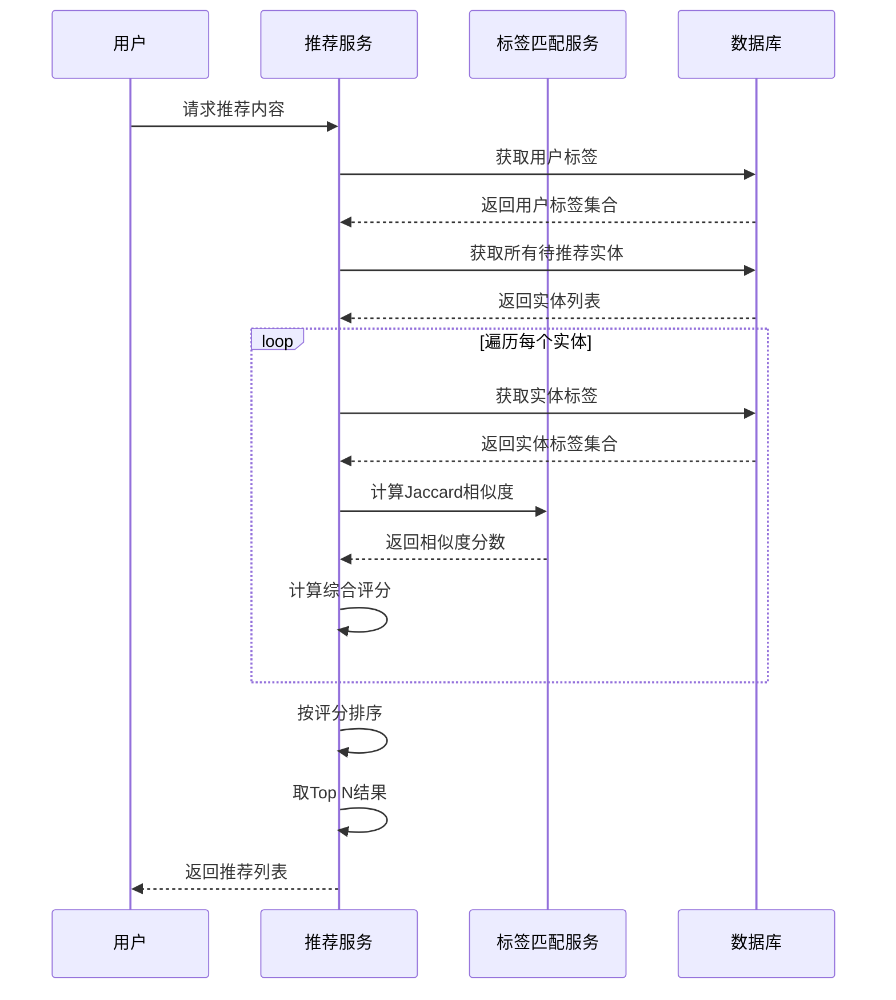

**代码实现**：

```java
public List<UniversalRecommendation> recommendAll(int userId, int limit) {
    // 1. 获取用户标签
    Set<Integer> userTagIds = getUserTagIds(userId);
    if (userTagIds.isEmpty()) {
        return new ArrayList<>();
    }

    List<UniversalRecommendation> results = new ArrayList<>();
    Map<Integer, Club> clubMap = buildClubMap();

    // 2. 推荐活动
    for (ClubActivity activity : clubActivityMapper.selectByStatusOrderByCreatedAtDesc(1)) {
        double similarity = tagMatchingService.calculateJaccardSimilarity(
            userTagIds, activityTagProvider.getTagIds(activity));
        if (similarity > 0) {
            Club club = clubMap.get(activity.getClubId());
            results.add(convertToUniversalRecommendation(
                ActivityTagProvider.ENTITY_TYPE,
                activity.getId(),
                activity.getTitle(),
                activity.getContent(),
                club != null ? club.getName() : "",
                activityTagProvider.getTagNames(activity),
                similarity));
        }
    }

    // 3. 推荐投票
    for (Vote vote : voteMapper.selectByStatus(1)) {
        double similarity = tagMatchingService.calculateJaccardSimilarity(
            userTagIds, voteTagProvider.getTagIds(vote));
        if (similarity > 0) {
            Club club = clubMap.get(vote.getClubId());
            results.add(convertToUniversalRecommendation(
                VoteTagProvider.ENTITY_TYPE,
                vote.getId(),
                vote.getTitle(),
                vote.getDescription(),
                club != null ? club.getName() : "",
                voteTagProvider.getTagNames(vote),
                similarity));
        }
    }

    // 4. 推荐招新帖
    for (RecruitmentPost post : recruitmentPostMapper.selectActivePosts()) {
        double similarity = tagMatchingService.calculateJaccardSimilarity(
            userTagIds, recruitmentTagProvider.getTagIds(post));
        if (similarity > 0) {
            Club club = post.getClubId() != null ? clubMap.get(post.getClubId()) : null;
            results.add(convertToUniversalRecommendation(
                RecruitmentTagProvider.ENTITY_TYPE,
                post.getId(),
                post.getTitle(),
                post.getContent(),
                club != null ? club.getName() : "",
                recruitmentTagProvider.getTagNames(post),
                similarity));
        }
    }

    // 5. 推荐问卷
    for (Questionnaire q : questionnaireMapper.selectActive()) {
        double similarity = tagMatchingService.calculateJaccardSimilarity(
            userTagIds, questionnaireTagProvider.getTagIds(q));
        if (similarity > 0) {
            Club club = clubMap.get(q.getClubId());
            results.add(convertToUniversalRecommendation(
                QuestionnaireTagProvider.ENTITY_TYPE,
                q.getId(),
                q.getTitle(),
                q.getDescription(),
                club != null ? club.getName() : "",
                questionnaireTagProvider.getTagNames(q),
                similarity));
        }
    }

    // 6. 按相似度排序并返回Top N
    return results.stream()
            .sorted(Comparator.comparingDouble(UniversalRecommendation::getSimilarity).reversed())
            .limit(limit)
            .collect(Collectors.toList());
}
```

### 4.4 冷启动推荐策略

#### 4.4.1 新用户冷启动

**场景描述**：
- 用户刚注册，没有历史行为数据
- 用户已选择兴趣标签

**推荐策略**：

1. **引导用户选择标签**：
   - 注册后引导用户选择至少3-5个兴趣标签
   - 提供热门标签推荐
   - 支持用户自定义标签

2. **基于标签的推荐**：
   - 使用Jaccard相似度计算用户标签与实体标签的匹配度
   - 推荐相似度大于0的实体
   - 按相似度从高到低排序

3. **热门内容补充**：
   - 当标签匹配结果不足时，补充热门内容
   - 热门内容按参与人数、浏览量、点赞数等指标排序

**推荐流程**：

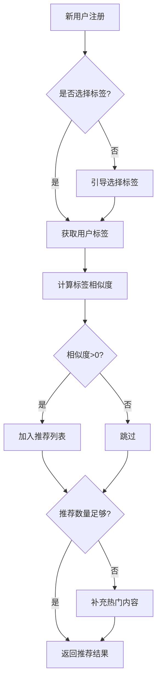

#### 4.4.2 新社团冷启动

**场景描述**：
- 社团刚创建，没有成员和活动数据
- 社团已设置标签和描述

**推荐策略**：

1. **完善社团信息**：
   - 引导社团管理员完善社团描述、标签、Logo等信息
   - 建议设置至少3-5个标签
   - 鼓励上传社团Logo和活动照片

2. **标签匹配推荐**：
   - 将社团标签与用户标签进行匹配
   - 推荐给标签匹配度高的用户

3. **新社团加权**：
   - 对新创建的社团给予一定的推荐加权
   - 在推荐列表中适当提升新社团的排名

4. **引导发布内容**：
   - 提醒社团管理员发布活动、招新帖等内容
   - 通过内容推荐增加社团曝光度

**推荐流程**：

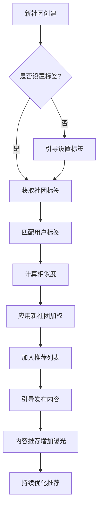

#### 4.4.3 新内容冷启动

**场景描述**：
- 新发布的活动、招新帖、问卷、投票等内容
- 缺乏互动数据（参与人数、浏览量等）

**推荐策略**：

1. **标签匹配推荐**：
   - 使用内容的标签与用户标签进行匹配
   - 推荐给标签匹配度高的用户

2. **时效性加权**：
   - 对新发布的内容给予时效性加权
   - 发布时间越近，加权越高

3. **社团成员优先**：
   - 优先推荐给社团成员
   - 提高内容的初始曝光度

4. **社交传播**：
   - 鼓励用户分享内容
   - 通过社交网络增加曝光

**推荐流程**：

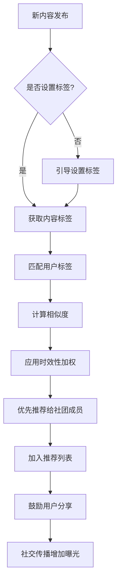

### 4.5 推荐系统优化

#### 4.5.1 性能优化

1. **缓存策略**：
   - 缓存用户标签数据，减少数据库查询
   - 缓存热门实体的标签数据
   - 使用Redis缓存推荐结果

2. **批量处理**：
   - 批量查询实体标签数据
   - 使用并行流处理推荐计算

3. **索引优化**：
   - 为标签相关查询建立索引
   - 优化数据库查询语句

#### 4.5.2 效果优化

1. **权重调优**：
   - 根据用户反馈调整推荐权重
   - A/B测试不同的权重配置

2. **多样性优化**：
   - 避免推荐结果过于单一
   - 引入随机性和多样性指标

3. **时效性优化**：
   - 对新内容给予更高的推荐权重
   - 定期更新推荐结果

#### 4.5.3 用户反馈

1. **显式反馈**：
   - 用户对推荐结果的评分
   - 用户对推荐结果的收藏、分享

2. **隐式反馈**：
   - 用户对推荐结果的点击率
   - 用户在推荐内容上的停留时间
   - 用户对推荐内容的参与度

3. **反馈应用**：
   - 根据用户反馈调整推荐策略
   - 过滤用户不感兴趣的内容

---

## 五、系统部署架构

### 5.1 部署架构图

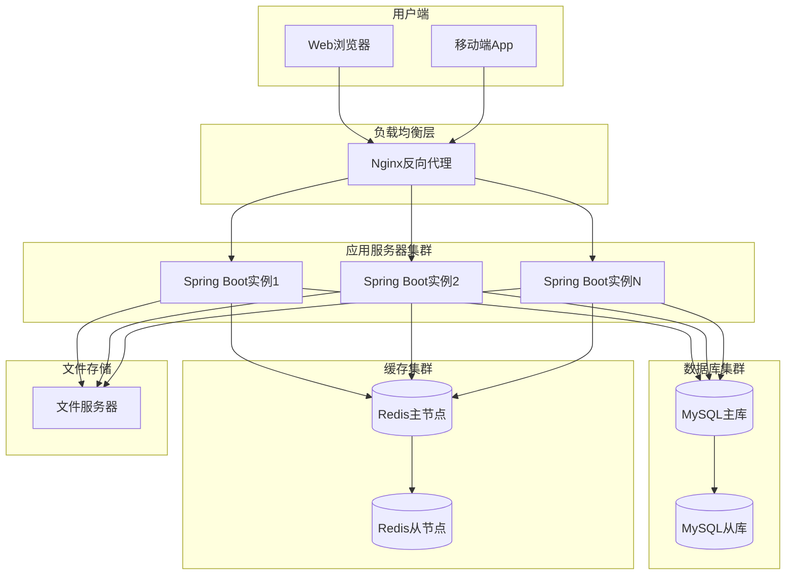

### 5.2 部署说明

1. **负载均衡**：
   - 使用Nginx作为反向代理和负载均衡器
   - 支持HTTPS、静态资源缓存、请求转发

2. **应用服务器**：
   - 部署多个Spring Boot实例
   - 支持水平扩展
   - 使用JWT实现无状态认证

3. **数据库集群**：
   - MySQL主从复制
   - 读写分离
   - 定期备份

4. **缓存集群**：
   - Redis主从复制
   - 哨兵模式保证高可用
   - 用于Session缓存和热点数据缓存

5. **文件存储**：
   - 本地文件系统或对象存储
   - 支持图片、文档等文件上传
   - 定期备份

---

## 六、系统安全设计

### 6.1 认证与授权

1. **JWT认证**：
   - 用户登录后生成JWT Token
   - Token包含用户ID、角色、过期时间等信息
   - Token存储在客户端，每次请求携带Token

2. **角色权限控制**：
   - 学生（role=0）：查看社团、活动、报名等
   - 社团管理员（role=社团ID+1）：管理社团信息、审核报名等
   - 平台管理员（role=1）：管理所有社团、用户、内容等

3. **接口权限验证**：
   - 使用拦截器验证Token有效性
   - 根据角色验证接口访问权限
   - 记录用户行为日志

### 6.2 数据安全

1. **密码加密**：
   - 使用BCrypt算法加密存储密码
   - 密码不可逆，防止泄露

2. **敏感信息保护**：
   - 身份证号、手机号等敏感信息加密存储
   - 日志中不记录敏感信息

3. **SQL注入防护**：
   - 使用MyBatis-Plus参数化查询
   - 禁止拼接SQL语句

4. **XSS防护**：
   - 前端输入内容转义
   - 后端验证输入内容

### 6.3 接口安全

1. **HTTPS加密**：
   - 使用HTTPS协议传输数据
   - 防止中间人攻击

2. **接口限流**：
   - 使用Redis实现接口限流
   - 防止恶意请求

3. **参数验证**：
   - 验证请求参数的合法性
   - 防止非法参数攻击

---

## 七、系统监控与运维

### 7.1 日志管理

1. **应用日志**：
   - 使用SLF4J + Logback记录应用日志
   - 日志级别：ERROR、WARN、INFO、DEBUG
   - 日志文件按天滚动，保留30天

2. **访问日志**：
   - 使用AOP记录所有Controller请求
   - 记录请求路径、参数、响应时间、IP等信息

3. **错误日志**：
   - 使用全局异常处理器捕获异常
   - 记录异常堆栈信息，便于排查问题

### 7.2 性能监控

1. **数据库性能**：
   - 监控慢查询日志
   - 定期优化索引和SQL语句

2. **缓存性能**：
   - 监控Redis缓存命中率
   - 监控内存使用情况

3. **应用性能**：
   - 监控JVM内存、CPU使用情况
   - 监控接口响应时间

### 7.3 备份策略

1. **数据库备份**：
   - 每日全量备份
   - 每小时增量备份
   - 备份文件保留7天

2. **文件备份**：
   - 每日备份上传的文件
   - 备份文件保留30天

3. **配置备份**：
   - 备份应用配置文件
   - 使用版本控制管理配置变更

---

## 八、总结

本系统采用前后端分离架构，后端使用Spring Boot + MyBatis-Plus + MySQL + Redis技术栈，前端使用Vue 3 + Vite + Vue Router + Axios技术栈。系统采用Maven多模块设计，模块职责清晰，易于维护和扩展。

数据库设计遵循规范化原则，使用索引优化查询性能，使用外键保证数据一致性。核心数据表包括用户表、标签表、社团表、活动表等，支持用户管理、社团管理、活动管理、招新管理等功能。

推荐系统采用基于标签的冷启动推荐策略，使用Jaccard相似度算法计算用户标签与实体标签的匹配度，通过标签相似度评分、隐藏标签匹配评分、QQ群加成评分等策略提高推荐准确性。系统支持新用户、新社团、新内容等冷启动场景的推荐，通过引导用户选择标签、完善实体信息、应用加权策略等方式解决冷启动问题。

系统部署采用负载均衡、应用服务器集群、数据库集群、缓存集群等架构，保证系统的高可用性和高性能。系统安全设计包括JWT认证、角色权限控制、数据加密、接口限流等措施，保证系统的安全性。系统监控与运维包括日志管理、性能监控、备份策略等，保证系统的稳定运行。
